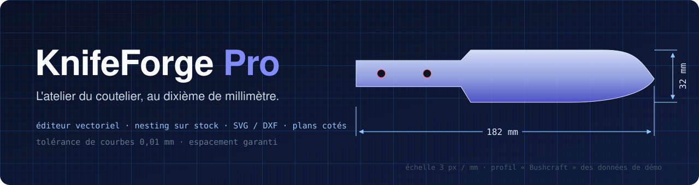
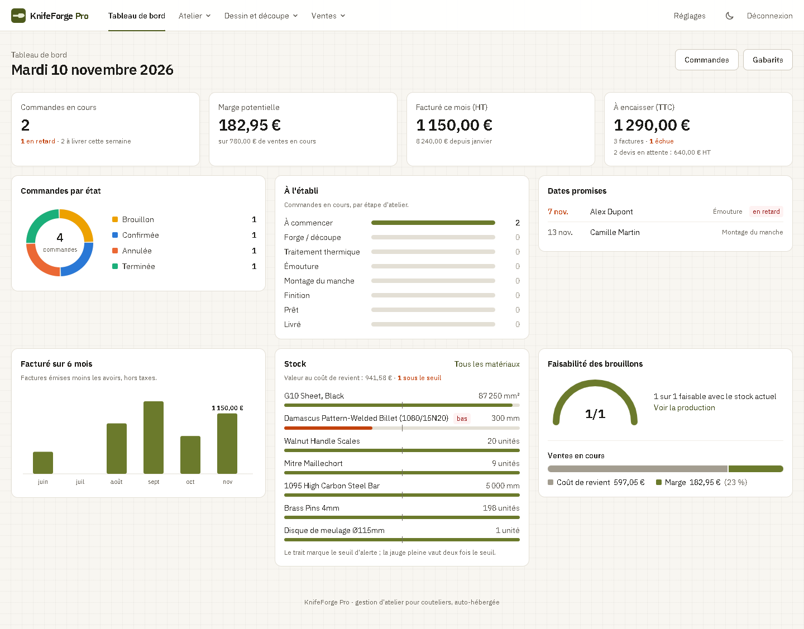
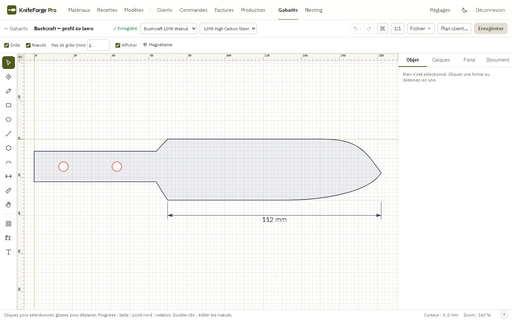
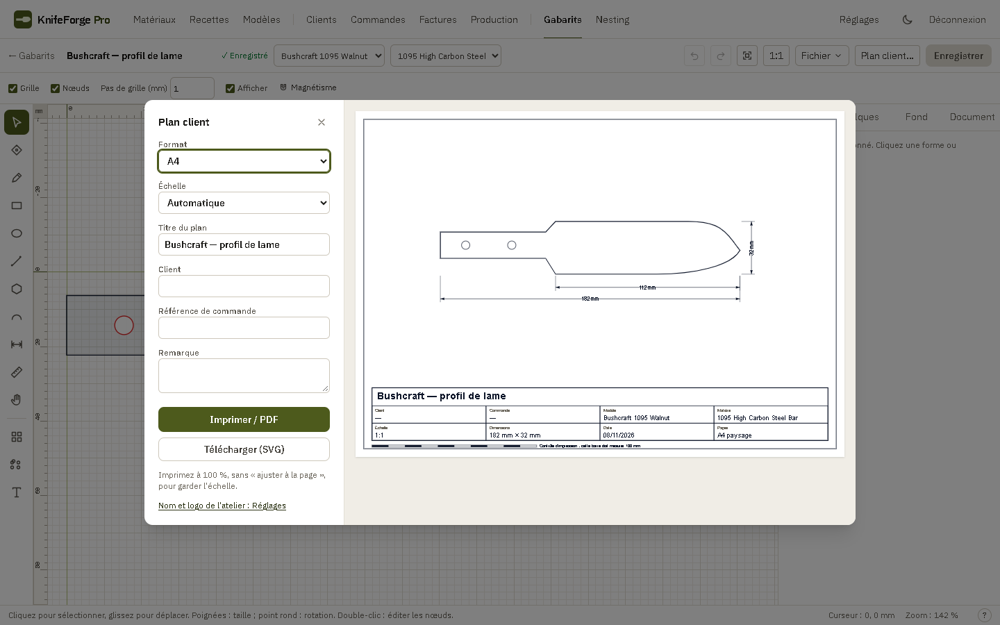
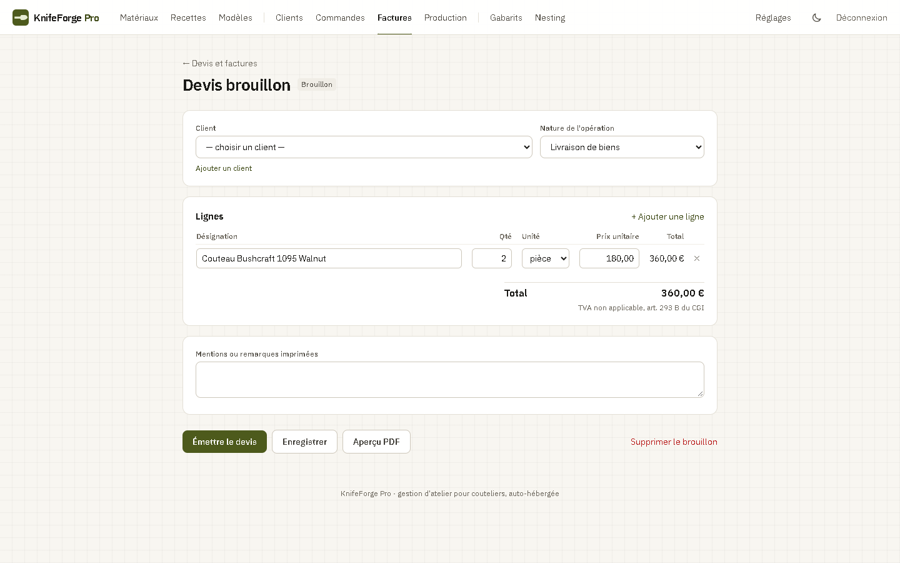
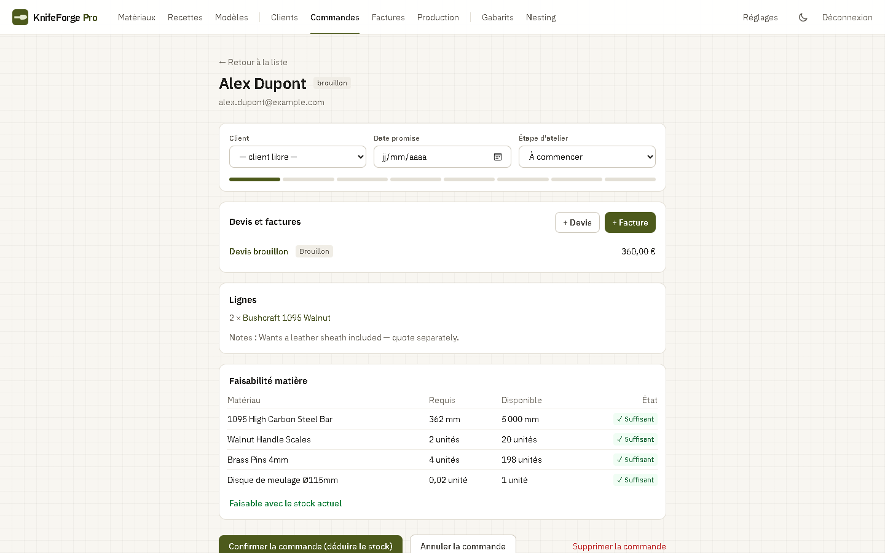
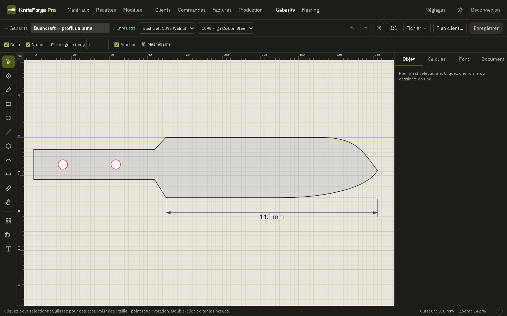
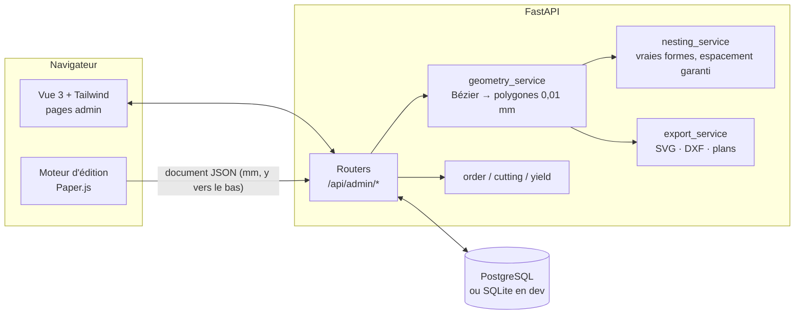

<div align="center">



<br>

**Gestion d'atelier auto-hébergée pour couteliers : stock, commandes, traitements,<br>
et un éditeur vectoriel intégré qui dessine, place et exporte vos pièces à la cote.**

<br>


<br>


<br>
[](https://github.com/philogone/knifeforge-pro/actions/workflows/ci.yml)
[](CHANGELOG.md)


### ⬇️ Installer KnifeForge Pro

[**Windows 10 / 11**](https://github.com/philogone/knifeforge-pro/releases/latest/download/KnifeForge-Pro-Windows.exe) ·
[**Linux** (AppImage, x86_64)](https://github.com/philogone/knifeforge-pro/releases/latest/download/KnifeForge-Pro-Linux-x86_64.AppImage) ·
[**macOS** (Apple Silicon)](https://github.com/philogone/knifeforge-pro/releases/latest/download/KnifeForge-Pro-macOS.dmg)

<sub>Dernière version · [toutes les versions](https://github.com/philogone/knifeforge-pro/releases) ·
[nouveautés](CHANGELOG.md) · [premier lancement](#demarrage)</sub>

[Installer](#demarrage) ·
[Fonctionnalités](#fonctionnalites) ·
[Captures](#captures) ·
[Précision](#precision) ·
[Démarrage](#demarrage) ·
[Architecture](#architecture) ·
[Tests](#tests) ·
[Guide](docs/guide/README.md) ·
[English](#english)

</div>

---

<a id="fonctionnalites"></a>

## ✨ Fonctionnalités

<table>
<tr>
<td width="50%" valign="top">

### ✒️ Éditeur vectoriel intégré
Un mini-Inkscape dans le navigateur, **à l'échelle 1:1 en millimètres**.
- Plume Bézier, édition de nœuds (on **tire un trait pour le courber**, comme dans Inkscape), rectangle, ellipse, ligne, polygone, **arc par 3 points**
- **Congé et chanfrein** sur les angles, au rayon saisi (arc tangent exact)
- **Longueur et angle tapés au clavier** pendant le tracé, **symétrie en direct** (on dessine une moitié de garde ou de plaquette)
- **Réseau de perçages** aux diamètres usuels (métriques et en pouces), **texte converti en contours** pour le poinçon ou une gravure
- Booléens (union, différence, intersection, exclusion), combiner / séparer
- Décalage (agrandir / réduire), alignement, miroir, rotation
- **Saisie numérique exacte** : tapez 123,4 × 17,6, vous obtenez 123,4 × 17,6
- **Bibliothèque de formes** paramétriques : 14 profils de lames dessinés avec leur talon (choil, garde et manche ergonomique, ou talon droit pour la cuisine), classés par familles : drop-point, clip, lance, tanto, wharncliffe, pied de mouton, pointe relevée, skinner, bowie, office, gyuto, santoku, nakiri, kiritsuke, plaquette, gardes, rondelle, fente de soie, et réutilisation de vos propres gabarits
- **Millimètres ou pouces** à l'affichage et à la saisie (règles en fractions de pouce), le dessin restant en millimètres
- **Crantage et dentelure** : rangée d'entailles en V, arrondies ou à fond plat, découpée dans la pièce le long d'un tronçon
- **Pliants** : rotation de la lame autour du pivot et vérification de la course (premier contact, jeu en fin de course)
- **Masse et point d'équilibre** estimés d'après les matières du stock, point marqué sur le dessin
- Calques typés : *découpe*, *perçage*, *gravure*, *émouture* (trait mixte sur le plan client, jamais découpée), *construction*, *cotation*
- **Décalque d'une photo** : image de fond JPEG / PNG / WebP calibrée en deux clics sur une distance connue, ou **redressée en perspective** sur les 4 coins d'une feuille A4 (ou de tout rectangle connu), jamais exportée
- **Outil mesure** (distance, ΔX, ΔY, angle), transformable en cote
- **Magnétisme complet** : nœuds, intersections, milieux, centres de perçages, contours, guides, grille ; angle bloqué par pas de 15° (Maj)
- Grille au pas libre (0,01 à 1000 mm), guides tirés depuis les règles, import SVG, annuler / rétablir

</td>
<td width="50%" valign="top">

### 🧩 Nesting réel sur stock
Placement des **vraies formes** (perçages compris) sur vos plaques et barres.
- Rotations au choix (libres, 0/180° pour le sens du grain, aucune)
- Espacement entre pièces **garanti au minimum**, marge de bord respectée
- Nombre de plaques / barres, taux d'utilisation, chute, comparaison au stock
- Reprend automatiquement les commandes en cours
- Lecture seule : un plan de découpe, pas un mouvement de stock

</td>
</tr>
<tr>
<td valign="top">

### 📐 Exports et plans clients
- **SVG** avec de vraies courbes de Bézier, 1 unité = 1 mm
- **DXF R2010** (calques `CUT` / `ENGRAVE` / `SHEET`) en polylignes ou **en arcs de cercle** (≤ 0,01 mm), pour la découpe laser, jet d'eau ou CNC
- **Compensation du trait de coupe** à l'export : la pièce sort à la cote
- **Contrôle de découpe** : pièces étalons à découper, fiche de relevé 1:1, calcul du trait réel, de l'échelle de la machine et de la compensation à saisir
- **Feuille de pièces PDF à l'échelle 1:1** (A4 / A3) à coller sur la matière : croix de pointage des perçages, grandes pièces réparties sur plusieurs pages à assembler
- **STL** : pièces extrudées pour imprimer en 3D un gabarit de traçage
- **Maquette 3D du couteau monté** : plaques empilées, goupilles, garde fendue, vue 3D ; 3MF ou STL pour l'impression 3D, DXF par plaque et contrôle de la fraise pour la CNC
- Plaques de nesting en SVG / DXF
- **Plans clients cotés** A4 / A3, échelle normalisée, cartouche au nom et au logo de l'atelier, **barre de contrôle de 100 mm** pour vérifier l'impression
- **Zoom 1:1 calibré** sur votre écran avec une carte bancaire

</td>
<td valign="top">

### 🗂️ Gestion d'atelier
- **Stock dimensionnel** : barres (mm), plaques (mm²), pièces (unités)
- **Commandes** brouillon → confirmée → terminée, déstockage tout-ou-rien
- **Recettes de traitement** thermiques et chimiques (trempe, revenu, attaque du damas, patine…)
- Optimiseur de découpe multi-commandes, catalogue de scies (trait de scie)
- Coût de revient, prix de vente suggéré, interface **FR / EN**, **mode sombre**
- **Suivi d'atelier** : étape de chaque commande (forge, trempe, émouture, manche, finition, prête, livrée), date promise
- **Historique de stock** : chaque entrée et sortie, avec sa raison et sa commande
- **Tableau de bord** à l'ouverture : commandes par état et par étape, dates promises, marge potentielle, facturé, impayés, niveaux de stock

</td>
</tr>
<tr>
<td valign="top">

### 🧾 Clients, devis et factures
- **Fichier clients** (particuliers et professionnels, SIREN, TVA intracommunautaire), export et effacement RGPD
- **Devis → facture → avoir**, numérotation continue sans trou (F-2026-0001), document figé à l'émission
- **Factur-X EN 16931** : PDF/A-3 lisible avec le XML structuré embarqué, conforme à la **réforme de la facturation électronique** (mentions obligatoires 2026 : SIREN du client, adresse de livraison, nature de l'opération, option TVA sur les débits)
- **Franchise en base** (art. 293 B du CGI) ou assujetti à la TVA, au choix dans les réglages
- **Factures d'acompte** depuis une commande, déduites de la facture de solde ; **encaissements** multiples (virement, carte, chèque, espèces), reste dû et retard calculés
- **Envoi par e-mail** des devis et factures (compte SMTP de l'atelier) et **relances** à trois niveaux, jusqu'à la mise en demeure, avec historique
- **Comptabilité** : chiffre d'affaires facturé et encaissé (déclaration URSSAF), TVA due par période selon son exigibilité, journal des ventes au format du FEC pour le comptable, liste des ventes CSV
- Chaque version fait valider des factures types (TVA, franchise, avoir, acompte, solde) par le validateur indépendant **Mustang**

</td>
<td valign="top">

### 🛠️ Installation et exploitation
- **Docker Compose** : une commande, PostgreSQL 16, en-têtes de sécurité et CSP stricte
- **Assistant de premier lancement** : nom, logo, données de démonstration à garder ou effacer
- **Sauvegarde nocturne** automatique et **sauvegarde / restauration complète** depuis l'interface
- **Migrations** appliquées seules à chaque mise à jour
- **Intégration continue** : tests sur SQLite et PostgreSQL à chaque modification

</td>
</tr>
</table>

<a id="captures"></a>

## 📸 En images

<table>
<tr>
<td colspan="2"><p align="center"><sub><b>Le tableau de bord</b> : commandes par état et à l'établi, dates promises, facturé sur 6 mois, jauges de stock (chiffres de démonstration).</sub></p></td>
</tr>
<tr>
<td colspan="2"><p align="center"><sub><b>L'éditeur</b> : profil de lame à l'échelle sur la grille millimétrée, perçages et cote de 112 mm.</sub></p></td>
</tr>
<tr>
<td width="50%"><p align="center"><sub><b>Nesting sur plaque</b> : 7 plaquettes G10 sur une plaque de 300 × 150 mm, commandes en cours comprises.</sub></p></td>
<td width="50%"><p align="center"><sub><b>Plan client</b> : A4 à l'échelle 1:1, cotes hors-tout, cartouche et barre de contrôle de 100 mm.</sub></p></td>
</tr>
<tr>
<td width="50%"><p align="center"><sub><b>Gabarits</b> : rattachés à un modèle de couteau et à une matière.</sub></p></td>
<td width="50%"><p align="center"><sub><b>Devis</b> : repris de la commande, total en direct, mention de franchise de TVA.</sub></p></td>
</tr>
<tr>
<td width="50%"><p align="center"><sub><b>Commande</b> : client, date promise, étape d'atelier et documents liés.</sub></p></td>
<td width="50%"><p align="center"><sub><b>Mode sombre</b> : l'interface s'assombrit, la plaque de dessin reste papier.</sub></p></td>
</tr>
</table>

<a id="precision"></a>

## 🎯 Le contrat de précision

> **Exigence de conception : une précision meilleure que 0,1 mm, de l'écran à la machine.**
> Chaque garantie ci-dessous est vérifiée par des tests (`backend/tests/test_precision.py`).

| Élément | Garantie |
|---|---|
| Coordonnées stockées | 0,0001 mm |
| SVG exporté | 0,001 mm, courbes de Bézier **non aplaties** |
| Aires, périmètres, DXF, nesting | courbes aplaties à **≤ 0,01 mm** (formule de Wang) |
| DXF en arcs (option) | Béziers converties en arcs de cercle à **≤ 0,01 mm**, vérifié dans les deux sens |
| Compensation du trait de coupe (option) | contours décalés de la moitié du trait (trous vers l'intérieur), arrondis ≤ 0,0005 mm |
| Espacement du nesting | **minimum garanti** : jamais sous la valeur demandée, excédent ≤ ~0,05 mm |
| Marge de bord | respectée au micron sur les polygones (≤ 0,01 mm d'écart sur les courbes) |
| Cercle / ellipse dessinés | Bézier à 4 nœuds : écart radial ≤ 0,027 % du rayon (0,03 mm pour R = 100 mm) |
| Saisie numérique | exacte : 123,4 × 17,6 s'enregistre en 123,4 × 17,6, aire 2171,84 mm² |

<details>
<summary><b>Ce qui n'est pas garanti, et pourquoi</b></summary>

<br>

- **L'écran n'est pas un instrument de mesure** : le zoom « 1:1 » suppose 96 dpi tant que l'écran n'est pas calibré (*Réglages › Affichage à taille réelle*, avec une carte bancaire). Fiez-vous aux cotes et aux champs numériques.
- **Imprimez les plans à 100 %**, sans « ajuster à la page », pour qu'ils soient à l'échelle.
- Un **SVG importé sans unité** est lu à 96 dpi : vérifiez-le avec une cote.
- Le **DXF** contient des polylignes aplaties à 0,01 mm, ou des arcs (option *DXF en arcs* du menu Fichier).
- Le **trait de coupe** (laser, jet d'eau) se compense à l'export (menu Fichier) ; le trait de scie reste porté par la scie pour le calcul de matière.
- Le **nesting est une heuristique** rapide et déterministe (bottom-left glouton avec compactage), pas un optimum mathématique.

Le détail des choix techniques est dans [`HANDOVER.md`](HANDOVER.md#knifeforge-pro--vector-designs-nesting-and-the-precision-contract).

</details>

<a id="demarrage"></a>

## 🚀 Démarrage rapide

### Sur un ordinateur (installeur, recommandé pour un atelier)

| Système | Télécharger | Premier lancement |
|---|---|---|
| **Windows 10 / 11** | [KnifeForge-Pro-Windows.exe](https://github.com/philogone/knifeforge-pro/releases/latest/download/KnifeForge-Pro-Windows.exe) | SmartScreen affiche « Windows a protégé votre ordinateur » (programme non signé) : *Informations complémentaires › Exécuter quand même*. |
| **Linux** x86_64 | [KnifeForge-Pro-Linux-x86_64.AppImage](https://github.com/philogone/knifeforge-pro/releases/latest/download/KnifeForge-Pro-Linux-x86_64.AppImage) | Rendre le fichier exécutable (*Propriétés › Autoriser l'exécution*, ou `chmod +x`), puis double-cliquer. Ubuntu 22.04, Debian 12, Fedora 38 ou plus récents. |
| **macOS** récent, puce Apple (M1 et suivantes) | [KnifeForge-Pro-macOS.dmg](https://github.com/philogone/knifeforge-pro/releases/latest/download/KnifeForge-Pro-macOS.dmg) | Glisser KnifeForge Pro dans Applications. Au premier lancement (application non notariée) : *Réglages Système › Confidentialité et sécurité › Ouvrir quand même*. |

Chaque version publie aussi `SHA256SUMS.txt` (empreintes des fichiers) et les rapports de
validation Factur-X. Le dépôt est public : les liens se téléchargent sans compte.

**Windows**, pas à pas :

1. Lancez `KnifeForge-Pro-Windows.exe` (aucun droit d'administrateur requis).
2. Ouvrez **KnifeForge Pro** depuis le bureau : votre navigateur s'ouvre sur l'application, et une
   petite fenêtre indique qu'elle tourne (la fermer arrête KnifeForge).
3. Au premier lancement, créez l'accès (email et mot de passe), puis laissez-vous guider.

| | |
|---|---|
| Programme | `%LOCALAPPDATA%\Programs\KnifeForge Pro` (Windows), le fichier AppImage (Linux), `Applications` (macOS) |
| Vos données | `%LOCALAPPDATA%\KnifeForge Pro` (Windows), `~/.local/share/knifeforge-pro` (Linux), `~/Library/Application Support/KnifeForge Pro` (macOS) : base `knifeforge.db`, réglages `config.json`, journaux |
| Sauvegardes | chaque jour dans `Sauvegardes\` ou le dossier choisi dans *Réglages › Sauvegarde automatique* (clé USB, second disque, dossier synchronisé) |
| Mise à jour | lancez l'installeur de la nouvelle version : la base est copiée dans `Sauvegardes avant mise à jour\` puis migrée au démarrage |
| Désinstallation | ne supprime jamais vos données |

L'application n'écoute que sur cet ordinateur (`127.0.0.1`) et n'envoie rien à l'extérieur.

**Mot de passe oublié** : KnifeForge fermé, ouvrez `config.json` dans le dossier des données,
supprimez les lignes `admin_email` et `admin_password_hash`, puis relancez : l'écran de création
de l'accès revient, vos données restent intactes.

Construire les installeurs soi-même : la CI les construit et les teste à chaque modification
(tâches *Windows installer*, *Linux AppImage*, *macOS app*) ; une étiquette `vX.Y.Z` égale au
fichier `VERSION` les publie avec les notes du [journal des versions](CHANGELOG.md). À la main : `cd frontend && npm run build`, puis
`cd backend && pip install -r requirements.txt -r requirements-desktop.txt && pyinstaller desktop/knifeforge.spec`,
puis `iscc /DAppVersion=$(cat VERSION) installer/knifeforge.iss` (Inno Setup 6).

Le [guide d'utilisation](docs/guide/README.md) suit une première journée pas à pas : dessiner
une lame, contrôler sa machine, nester, commander, facturer, sauvegarder.

### Démo publique (lecture seule)

`docker-compose.demo.yml` lance un atelier fictif ouvert à tous, sans mot de passe : toutes les
pages, les calculs et les exports fonctionnent, aucune modification n'est enregistrée, et la base
est reconstruite à chaque démarrage. `DEMO_SECRET_KEY=$(openssl rand -hex 32) docker compose -f
docker-compose.demo.yml up -d --build`, puis http://localhost:8090.

### Avec Docker (serveur, NAS)

```bash
cp .env.example .env
# Renseignez SECRET_KEY, POSTGRES_PASSWORD, ADMIN_EMAIL, ADMIN_PASSWORD_HASH (voir ci-dessous)
docker compose up -d --build
```

L'admin est disponible sur **http://localhost:8080**.

Générez le hash du mot de passe admin :

```bash
docker compose run --rm backend python scripts/hash_password.py "VotreMotDePasseFort"
```

> [!WARNING]
> Un hash bcrypt contient des `$` (`$2b$12$…`). Docker Compose les interprète comme des variables
> et les supprime silencieusement. **Doublez chaque `$`** dans `.env` :
> `ADMIN_PASSWORD_HASH=$$2b$$12$$RRlpfX93...`

### En local, sans Docker (développement)

<details>
<summary>Backend FastAPI + SQLite, frontend Vite</summary>

<br>

**Backend** (Python 3.12+ ; `psycopg2` n'est pas nécessaire avec SQLite) :

```bash
cd backend
python -m venv .venv
.venv/Scripts/activate            # Windows ; sous macOS/Linux : source .venv/bin/activate
pip install -r requirements.txt   # sous Python 3.13, retirez psycopg2-binary de la liste
python scripts/hash_password.py "MotDePasseDeTest"
```

Créez `backend/.env` (jamais commité) :

```ini
SECRET_KEY=<64 caractères hexadécimaux aléatoires>
DATABASE_URL=sqlite:///./dev.db
ADMIN_EMAIL=admin@test.local
ADMIN_PASSWORD_HASH='<hash généré ci-dessus, entre apostrophes>'
FRONTEND_URL=http://localhost:5173
```

Créez ou mettez à jour les tables (migrations Alembic, comme en production), puis lancez le serveur (les données de démo se créent au démarrage) :

```bash
alembic upgrade head
uvicorn app.main:app --port 8000
```

**Frontend** (le proxy `/api` vers le port 8000 est déjà configuré) :

```bash
cd frontend
npm install
npm run dev                       # http://localhost:5173
```

</details>

<a id="architecture"></a>

## 💾 Sauvegardes et mises à jour

- **Chaque nuit** (Docker) : le service `backup` écrit `backups/knifeforge-AAAA-MM-JJ.sql.gz` et garde 14 jours (`BACKUP_KEEP_DAYS`). Restauration :
  `gunzip -c backups/knifeforge-AAAA-MM-JJ.sql.gz | docker compose exec -T db psql -U knifeforge knifeforge`
- **À la demande** : *Réglages › Sauvegarde des données › Télécharger une sauvegarde complète*, puis *Restaurer une sauvegarde…* sur la même version de l'application (tout ou rien, en une transaction).
- **Mettre à jour** : remplacez le code par la nouvelle version, puis `docker compose up -d --build`. Les migrations de base de données s'appliquent seules au démarrage du backend ; faites une sauvegarde juste avant.
- **Premier lancement** : un assistant (*/bienvenue*) demande le nom et le logo de l'atelier et propose de garder ou d'effacer les données de démonstration.

## 🏗️ Architecture



Un **gabarit** est un document JSON (calques + chemins de Bézier + cotes) en millimètres. Les
dimensions, aires et nombres de pièces sont **recalculés côté serveur** à chaque enregistrement
(Shapely) : la liste et le nesting ne font jamais confiance aux valeurs envoyées par le client.
Le **rôle du calque** fait contrat : `cut` est découpé et placé, `hole` est soustrait des pièces
qu'il recouvre, `engrave` est exporté mais jamais placé, `construction` est ignoré, `dimension`
alimente les plans.

<details>
<summary><b>Le modèle métier en détail</b></summary>

<br>

- **Matériaux** : stock dimensionnel selon le type, `length` (barres/tiges, en mm), `area` (plaques, en mm²) ou `count` (pièces discrètes, en unités).
- **Calculateur de rendement** : combien de pièces par barre ou plaque standard, la perte (trait de scie inclus pour les barres), combien en acheter.
- **Modèles de couteaux** : liste de matériaux requis (avec leurs cotes de découpe) et **séquence ordonnée** de recettes de traitement.
- **Recettes de traitement** : un seul format pour le thermique (trempe, revenu) et le chimique / finition (révélation du damas, bronzage, patine forcée), en étapes ordonnées avec température, durée et médium.
- **Commandes** : `draft` → `confirmed` → `completed`, ou annulée avant `completed`. La confirmation vérifie le stock pour **toutes** les lignes et déstocke en une transaction, tout ou rien. Annuler une commande confirmée **restitue** le stock.
- **Catalogue scies / lames** : le trait de scie dépend de l'outil, pas de la matière. Choisir une scie sur un matériau préremplit son `kerf_mm`.
- **Optimiseur multi-commandes** : pour les barres, regroupe la demande de toutes les commandes en brouillon et calcule un plan de découpe First-Fit-Decreasing, avec rendu visuel.
- **Production** : chaque commande en brouillon face au stock actuel, et la demande matière agrégée.
- **Taxonomie** : type de métal, nuance d'acier, essence et qualité de bois, désignation de pièce, en texte libre avec suggestions.
- **Coût de revient et prix suggéré** : coût moyen pondéré mis à jour à chaque achat (port compris), coût matière ligne par ligne, main d'œuvre, prix selon une marge cible.
- **Bilingue FR / EN** et export JSON complet de vos données.

</details>

<details>
<summary><b>Arborescence</b></summary>

<br>

```
knifeforge-pro/
├── backend/app/
│   ├── models/          material, saw_blade, treatment, knife_model, order, design
│   ├── routers/         auth, materials, saw_blades, treatments, knife_models,
│   │                    orders, production, designs, nesting, settings
│   └── services/
│       ├── geometry_service.py   Aplatissement Bézier, pièces/perçages, métriques, offset
│       ├── nesting_service.py    Nesting vraies formes, espacement garanti
│       ├── export_service.py     SVG / DXF (ezdxf) / plans clients cotés
│       ├── cutting_service.py    Optimiseur de découpe multi-commandes (FFD)
│       ├── yield_service.py      Calcul de rendement
│       ├── order_service.py      Faisabilité, déstockage / restockage
│       └── seed_service.py       Données de démo (via les vrais services)
├── frontend/src/
│   ├── editor/          Moteur Paper.js, outils, historique, grille et règles (+ tests)
│   ├── pages/admin/     Matériaux, modèles, recettes, commandes, production,
│   │                    gabarits, éditeur, nesting, réglages
│   ├── components/      Rendus des barres, plaques et nesting
│   ├── composables/     Client API, état « modifié »
│   └── i18n/            Dictionnaires FR / EN
├── docs/                Bannière et captures du README
├── docker-compose.yml
├── HANDOVER.md          Les décisions de conception, et pourquoi
└── README.md
```

</details>

<a id="tests"></a>

## 🧪 Tests

```bash
cd backend && pytest              # 182 tests : géométrie, nesting, exports, API, métrologie
cd frontend && npm test           # 167 tests : moteur d'édition, calibration, perspective, magnétisme, congés, texte, formes, client API, traductions
cd frontend && npx vue-tsc --noEmit && npm run build
```

Avec Docker : `docker compose exec backend pytest`.

Les tests de géométrie comparent à des **valeurs calculées indépendamment** (aire d'un cercle,
distances exactes) avec une tolérance explicite inférieure à 0,1 mm, jamais à un instantané de
la sortie actuelle.

## 🗺️ Limites connues et suite

- Pas de style par objet (remplissage / trait), pas de groupes, pas d'objets texte
- La transmission des factures à une **plateforme agréée** (obligatoire en émission au 1er septembre 2027 pour les TPE/PME) se fait en déposant le PDF Factur-X sur la plateforme choisie : pas de connexion directe
- Les matériaux comptés à l'unité ne sont pas « nestables »
- Le nesting n'utilise pas les chutes existantes
- L'outil de cotation ne place que des cotes alignées
- Volontairement hors périmètre : traçabilité lot / numéro de série, comptabilité générale, factures fournisseurs, vitrine publique

<a id="english"></a>

## 🇬🇧 In English

**KnifeForge Pro** is a self-hosted shop manager for custom knifemakers: dimensional raw-material
stock (bars in mm, sheets in mm², counted parts), orders with all-or-nothing stock deduction,
heat-treatment and finishing recipes, costing, customers, **quotes, invoices and credit notes
in Factur-X (EN 16931)**, workshop progress tracking and a stock ledger, plus an **integrated
vector editor** (Paper.js) for real-scale millimetre patterns, **true-shape nesting** on sheets
and bars, **SVG / DXF export** (polylines or arcs, optional kerf compensation) and
**dimensioned client plans**.

The precision target is **better than 0.1 mm**: coordinates are stored to 0.0001 mm, SVG keeps
true Béziers (0.001 mm), areas / DXF / nesting flatten curves to ≤ 0.01 mm, and nesting spacing
is a hard minimum. Caveats: the screen is only true-size once calibrated (Settings, with a bank card),
print plans at 100 % (a 100 mm check bar is printed), unit-less imported SVG is read at 96 dpi,
and nesting is a fast deterministic heuristic.

Quick start: `cp .env.example .env`, fill in the secrets (double every `$` of the bcrypt hash),
then `docker compose up -d --build` and open http://localhost:8080. Design rationale lives in
[`HANDOVER.md`](HANDOVER.md).

## 📄 Licence

Logiciel **libre et gratuit**, sous licence **GNU AGPL v3** : voir [`LICENSE`](LICENSE) et les
avertissements de [`NOTICE.md`](NOTICE.md) (données, factures, calculs d'atelier).
Commercial software, not open source. See [`LICENSE`](LICENSE).

<div align="center">
<sub>Fait pour l'atelier, avec un pied à coulisse à portée de main. 🔪</sub>
</div>
