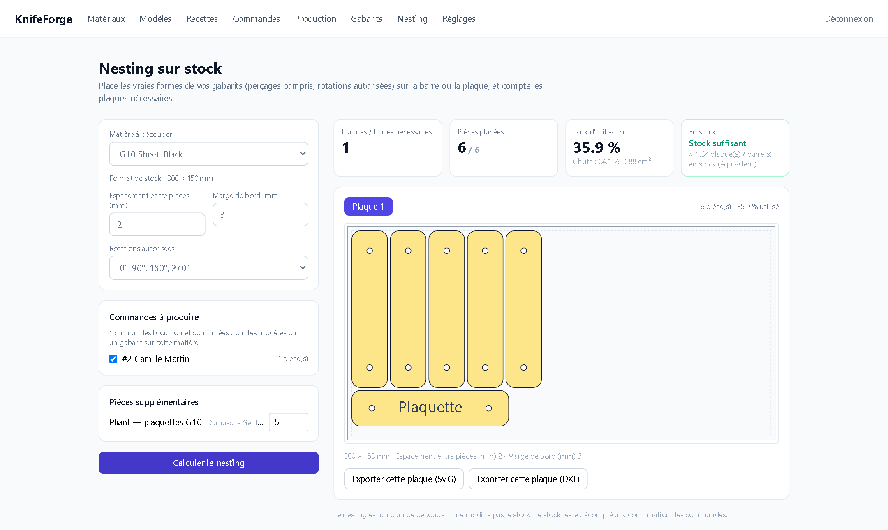
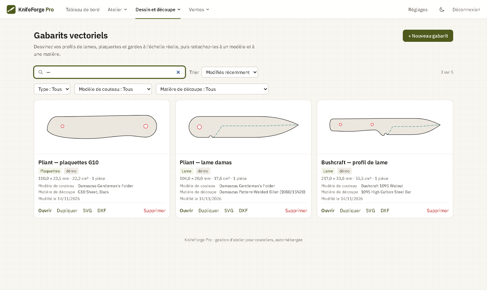
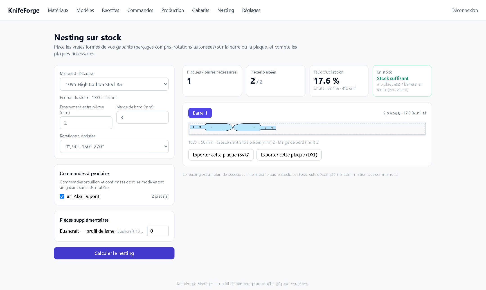
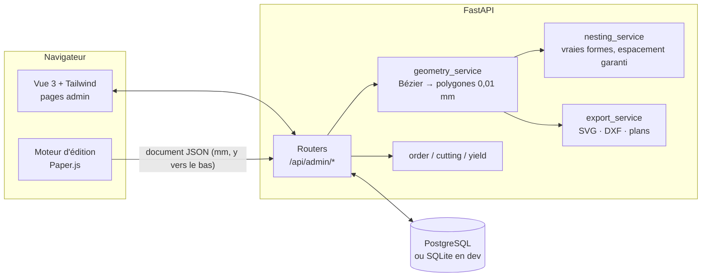

<div align="center">


<br>

**Gestion d'atelier auto-hébergée pour couteliers : stock, commandes, traitements,<br>
et un éditeur vectoriel intégré qui dessine, place et exporte vos pièces à la cote.**

<br>


<br>


[Fonctionnalités](#fonctionnalites) ·
[Captures](#captures) ·
[Précision](#precision) ·
[Démarrage](#demarrage) ·
[Architecture](#architecture) ·
[Tests](#tests) ·
[English](#english)

</div>

---

<a id="fonctionnalites"></a>

## ✨ Fonctionnalités

<table>
<tr>
<td width="50%" valign="top">

### ✒️ Éditeur vectoriel intégré
Un mini-Inkscape dans le navigateur, **à l'échelle 1:1 en millimètres**.
- Plume Bézier, édition de nœuds (on **tire un trait pour le courber**, comme dans Inkscape), rectangle, ellipse, ligne, polygone, **arc par 3 points**
- **Congé et chanfrein** sur les angles, au rayon saisi (arc tangent exact)
- **Longueur et angle tapés au clavier** pendant le tracé, **symétrie en direct** (on dessine une moitié de garde ou de plaquette)
- **Réseau de perçages** aux diamètres usuels (métriques et en pouces), **texte converti en contours** pour le poinçon ou une gravure
- Booléens (union, différence, intersection, exclusion), combiner / séparer
- Décalage (agrandir / réduire), alignement, miroir, rotation
- **Saisie numérique exacte** : tapez 123,4 × 17,6, vous obtenez 123,4 × 17,6
- **Bibliothèque de formes** paramétriques (plaquette, gardes, rondelle, fente de soie, lames drop-point et wharncliffe) et réutilisation de vos propres gabarits
- Calques typés : *découpe*, *perçage*, *gravure*, *émouture* (trait mixte sur le plan client, jamais découpée), *construction*, *cotation*
- **Décalque d'une photo** : image de fond JPEG / PNG / WebP calibrée en deux clics sur une distance connue, ou **redressée en perspective** sur les 4 coins d'une feuille A4 (ou de tout rectangle connu), jamais exportée
- **Outil mesure** (distance, ΔX, ΔY, angle), transformable en cote
- **Magnétisme complet** : nœuds, intersections, milieux, centres de perçages, contours, guides, grille ; angle bloqué par pas de 15° (Maj)
- Grille au pas libre (0,01 à 1000 mm), guides tirés depuis les règles, import SVG, annuler / rétablir

</td>
<td width="50%" valign="top">

### 🧩 Nesting réel sur stock
Placement des **vraies formes** (perçages compris) sur vos plaques et barres.
- Rotations au choix (libres, 0/180° pour le sens du grain, aucune)
- Espacement entre pièces **garanti au minimum**, marge de bord respectée
- Nombre de plaques / barres, taux d'utilisation, chute, comparaison au stock
- Reprend automatiquement les commandes en cours
- Lecture seule : un plan de découpe, pas un mouvement de stock

</td>
</tr>
<tr>
<td valign="top">

### 📐 Exports et plans clients
- **SVG** avec de vraies courbes de Bézier, 1 unité = 1 mm
- **DXF R2010** (polylignes, calques `CUT` / `ENGRAVE` / `SHEET`) pour la découpe laser, jet d'eau ou CNC
- Plaques de nesting en SVG / DXF
- **Plans clients cotés** A4 / A3, échelle normalisée, cartouche complet, prêts à imprimer

</td>
<td valign="top">

### 🗂️ Gestion d'atelier
- **Stock dimensionnel** : barres (mm), plaques (mm²), pièces (unités)
- **Commandes** brouillon → confirmée → terminée, déstockage tout-ou-rien
- **Recettes de traitement** thermiques et chimiques (trempe, revenu, attaque du damas, patine…)
- Optimiseur de découpe multi-commandes, catalogue de scies (trait de scie)
- Coût de revient, prix de vente suggéré, interface **FR / EN**

</td>
</tr>
</table>

<a id="captures"></a>

## 📸 En images

<table>
<tr>
<td colspan="2"><p align="center"><sub><b>L'éditeur</b> : profil de lame à l'échelle, poignées, cote de 112 mm et saisie numérique de la position et de la taille.</sub></p></td>
</tr>
<tr>
<td width="50%"><p align="center"><sub><b>Nesting sur plaque</b> : 6 plaquettes G10 sur une plaque de 300 × 150 mm.</sub></p></td>
<td width="50%"><p align="center"><sub><b>Plan client</b> : A4 à l'échelle 1:1, cotes hors-tout et cartouche.</sub></p></td>
</tr>
<tr>
<td width="50%"><p align="center"><sub><b>Gabarits</b> : rattachés à un modèle de couteau et à une matière.</sub></p></td>
<td width="50%"><p align="center"><sub><b>Nesting sur barre</b> : deux lames tête-bêche sur une barre de 1095.</sub></p></td>
</tr>
</table>

<a id="precision"></a>

## 🎯 Le contrat de précision

> **Exigence de conception : une précision meilleure que 0,1 mm, de l'écran à la machine.**
> Chaque garantie ci-dessous est vérifiée par des tests (`backend/tests/test_precision.py`).

| Élément | Garantie |
|---|---|
| Coordonnées stockées | 0,0001 mm |
| SVG exporté | 0,001 mm, courbes de Bézier **non aplaties** |
| Aires, périmètres, DXF, nesting | courbes aplaties à **≤ 0,01 mm** (formule de Wang) |
| Espacement du nesting | **minimum garanti** : jamais sous la valeur demandée, excédent ≤ ~0,05 mm |
| Marge de bord | respectée au micron sur les polygones (≤ 0,01 mm d'écart sur les courbes) |
| Cercle / ellipse dessinés | Bézier à 4 nœuds : écart radial ≤ 0,027 % du rayon (0,03 mm pour R = 100 mm) |
| Saisie numérique | exacte : 123,4 × 17,6 s'enregistre en 123,4 × 17,6, aire 2171,84 mm² |

<details>
<summary><b>Ce qui n'est pas garanti, et pourquoi</b></summary>

<br>

- **L'écran n'est pas un instrument de mesure** : le zoom « 1:1 » suppose 96 dpi. Fiez-vous aux cotes et aux champs numériques.
- **Imprimez les plans à 100 %**, sans « ajuster à la page », pour qu'ils soient à l'échelle.
- Un **SVG importé sans unité** est lu à 96 dpi : vérifiez-le avec une cote.
- Le **DXF contient des polylignes** (pas d'arcs), aplaties à 0,01 mm.
- Le **trait de scie et l'offset laser** ne sont pas compensés automatiquement : utilisez l'outil *Décalage*.
- Le **nesting est une heuristique** rapide et déterministe (bottom-left glouton avec compactage), pas un optimum mathématique.

Le détail des choix techniques est dans [`HANDOVER.md`](HANDOVER.md#knifeforge-pro--vector-designs-nesting-and-the-precision-contract).

</details>

<a id="demarrage"></a>

## 🚀 Démarrage rapide

### Avec Docker (production)

```bash
cp .env.example .env
# Renseignez SECRET_KEY, POSTGRES_PASSWORD, ADMIN_EMAIL, ADMIN_PASSWORD_HASH (voir ci-dessous)
docker compose up -d --build
```

L'admin est disponible sur **http://localhost:8080**.

Générez le hash du mot de passe admin :

```bash
docker compose run --rm backend python scripts/hash_password.py "VotreMotDePasseFort"
```

> [!WARNING]
> Un hash bcrypt contient des `$` (`$2b$12$…`). Docker Compose les interprète comme des variables
> et les supprime silencieusement. **Doublez chaque `$`** dans `.env` :
> `ADMIN_PASSWORD_HASH=$$2b$$12$$RRlpfX93...`

### En local, sans Docker (développement)

<details>
<summary>Backend FastAPI + SQLite, frontend Vite</summary>

<br>

**Backend** (Python 3.12+ ; `psycopg2` n'est pas nécessaire avec SQLite) :

```bash
cd backend
python -m venv .venv
.venv/Scripts/activate            # Windows ; sous macOS/Linux : source .venv/bin/activate
pip install -r requirements.txt   # sous Python 3.13, retirez psycopg2-binary de la liste
python scripts/hash_password.py "MotDePasseDeTest"
```

Créez `backend/.env` (jamais commité) :

```ini
SECRET_KEY=<64 caractères hexadécimaux aléatoires>
DATABASE_URL=sqlite:///./dev.db
ADMIN_EMAIL=admin@test.local
ADMIN_PASSWORD_HASH='<hash généré ci-dessus, entre apostrophes>'
FRONTEND_URL=http://localhost:5173
```

Créez les tables puis lancez le serveur (les données de démo se créent au démarrage) :

```bash
python -c "import app.models; from app.database import Base, engine; Base.metadata.create_all(engine)"
uvicorn app.main:app --port 8000
```

**Frontend** (le proxy `/api` vers le port 8000 est déjà configuré) :

```bash
cd frontend
npm install
npm run dev                       # http://localhost:5173
```

</details>

<a id="architecture"></a>

## 🏗️ Architecture



Un **gabarit** est un document JSON (calques + chemins de Bézier + cotes) en millimètres. Les
dimensions, aires et nombres de pièces sont **recalculés côté serveur** à chaque enregistrement
(Shapely) : la liste et le nesting ne font jamais confiance aux valeurs envoyées par le client.
Le **rôle du calque** fait contrat : `cut` est découpé et placé, `hole` est soustrait des pièces
qu'il recouvre, `engrave` est exporté mais jamais placé, `construction` est ignoré, `dimension`
alimente les plans.

<details>
<summary><b>Le modèle métier en détail</b></summary>

<br>

- **Matériaux** : stock dimensionnel selon le type, `length` (barres/tiges, en mm), `area` (plaques, en mm²) ou `count` (pièces discrètes, en unités).
- **Calculateur de rendement** : combien de pièces par barre ou plaque standard, la perte (trait de scie inclus pour les barres), combien en acheter.
- **Modèles de couteaux** : liste de matériaux requis (avec leurs cotes de découpe) et **séquence ordonnée** de recettes de traitement.
- **Recettes de traitement** : un seul format pour le thermique (trempe, revenu) et le chimique / finition (révélation du damas, bronzage, patine forcée), en étapes ordonnées avec température, durée et médium.
- **Commandes** : `draft` → `confirmed` → `completed`, ou annulée avant `completed`. La confirmation vérifie le stock pour **toutes** les lignes et déstocke en une transaction, tout ou rien. Annuler une commande confirmée **restitue** le stock.
- **Catalogue scies / lames** : le trait de scie dépend de l'outil, pas de la matière. Choisir une scie sur un matériau préremplit son `kerf_mm`.
- **Optimiseur multi-commandes** : pour les barres, regroupe la demande de toutes les commandes en brouillon et calcule un plan de découpe First-Fit-Decreasing, avec rendu visuel.
- **Production** : chaque commande en brouillon face au stock actuel, et la demande matière agrégée.
- **Taxonomie** : type de métal, nuance d'acier, essence et qualité de bois, désignation de pièce, en texte libre avec suggestions.
- **Coût de revient et prix suggéré** : coût moyen pondéré mis à jour à chaque achat (port compris), coût matière ligne par ligne, main d'œuvre, prix selon une marge cible.
- **Bilingue FR / EN** et export JSON complet de vos données.

</details>

<details>
<summary><b>Arborescence</b></summary>

<br>

```
knifeforge-pro/
├── backend/app/
│   ├── models/          material, saw_blade, treatment, knife_model, order, design
│   ├── routers/         auth, materials, saw_blades, treatments, knife_models,
│   │                    orders, production, designs, nesting, settings
│   └── services/
│       ├── geometry_service.py   Aplatissement Bézier, pièces/perçages, métriques, offset
│       ├── nesting_service.py    Nesting vraies formes, espacement garanti
│       ├── export_service.py     SVG / DXF (ezdxf) / plans clients cotés
│       ├── cutting_service.py    Optimiseur de découpe multi-commandes (FFD)
│       ├── yield_service.py      Calcul de rendement
│       ├── order_service.py      Faisabilité, déstockage / restockage
│       └── seed_service.py       Données de démo (via les vrais services)
├── frontend/src/
│   ├── editor/          Moteur Paper.js, outils, historique, grille et règles (+ tests)
│   ├── pages/admin/     Matériaux, modèles, recettes, commandes, production,
│   │                    gabarits, éditeur, nesting, réglages
│   ├── components/      Rendus des barres, plaques et nesting
│   ├── composables/     Client API, état « modifié »
│   └── i18n/            Dictionnaires FR / EN
├── docs/                Bannière et captures du README
├── docker-compose.yml
├── HANDOVER.md          Les décisions de conception, et pourquoi
└── README.md
```

</details>

<a id="tests"></a>

## 🧪 Tests

```bash
cd backend && pytest              # 89 tests : géométrie, nesting, exports, API, métrologie
cd frontend && npm test           # 134 tests : moteur d'édition, calibration, perspective, magnétisme, congés, texte, formes, client API, traductions
cd frontend && npx vue-tsc --noEmit && npm run build
```

Avec Docker : `docker compose exec backend pytest`.

Les tests de géométrie comparent à des **valeurs calculées indépendamment** (aire d'un cercle,
distances exactes) avec une tolérance explicite inférieure à 0,1 mm, jamais à un instantané de
la sortie actuelle.

## 🗺️ Limites connues et suite

- Pas de style par objet (remplissage / trait), pas de groupes, pas d'objets texte
- DXF en polylignes uniquement (les arcs ne sont pas conservés)
- Les matériaux comptés à l'unité ne sont pas « nestables »
- Le nesting n'utilise pas les chutes existantes
- L'outil de cotation ne place que des cotes alignées
- Volontairement hors périmètre : traçabilité lot / numéro de série, frais généraux, fournisseurs et factures, vitrine publique

<a id="english"></a>

## 🇬🇧 In English

**KnifeForge Pro** is a self-hosted shop manager for custom knifemakers: dimensional raw-material
stock (bars in mm, sheets in mm², counted parts), orders with all-or-nothing stock deduction,
heat-treatment and finishing recipes, costing, plus an **integrated vector editor** (Paper.js)
for real-scale millimetre patterns, **true-shape nesting** on sheets and bars, **SVG / DXF export**
and **dimensioned client plans**.

The precision target is **better than 0.1 mm**: coordinates are stored to 0.0001 mm, SVG keeps
true Béziers (0.001 mm), areas / DXF / nesting flatten curves to ≤ 0.01 mm, and nesting spacing
is a hard minimum. Caveats: the screen is not a measuring tool (print plans at 100 %), unit-less
imported SVG is read at 96 dpi, DXF carries polylines, saw kerf is not auto-compensated, and
nesting is a fast deterministic heuristic.

Quick start: `cp .env.example .env`, fill in the secrets (double every `$` of the bcrypt hash),
then `docker compose up -d --build` and open http://localhost:8080. Design rationale lives in
[`HANDOVER.md`](HANDOVER.md).

## 📄 Licence

Logiciel **commercial**, non open source. Voir [`LICENSE`](LICENSE).
Commercial software, not open source. See [`LICENSE`](LICENSE).

<div align="center">
<sub>Fait pour l'atelier, avec un pied à coulisse à portée de main. 🔪</sub>
</div>
