# Guide de KnifeForge Pro

De l'esquisse à la facture, pas à pas. Ce guide suit l'ordre d'une première journée : installer,
dessiner une lame, vérifier sa machine, placer les pièces sur la matière, prendre la commande,
facturer, sauvegarder. Chaque partie dit aussi **ce que l'outil ne fait pas**, pour ne jamais
compter sur une fonction qui n'existe pas.

Les captures montrent les données de démonstration fournies à l'installation : vous pouvez les
garder pour vous entraîner, puis les effacer d'un clic (*Réglages › Données de démonstration*).

1. [Installer et ouvrir KnifeForge](#1-installer-et-ouvrir-knifeforge)
2. [Le tableau de bord](#2-le-tableau-de-bord)
3. [Dessiner une lame](#3-dessiner-une-lame)
4. [Les outils du coutelier](#4-les-outils-du-coutelier)
5. [Exporter pour la machine, imprimer pour l'établi](#5-exporter-pour-la-machine-imprimer-pour-létabli)
6. [Contrôler sa découpe (planche de contrôle)](#6-contrôler-sa-découpe)
7. [Placer les pièces sur la matière (nesting)](#7-placer-les-pièces-sur-la-matière)
8. [Prendre une commande et la suivre à l'atelier](#8-prendre-une-commande-et-la-suivre)
9. [Devis, factures, acomptes, encaissements, relances, comptabilité](#9-devis-factures-et-avoirs)
10. [Sauvegarder, mettre à jour, déménager](#10-sauvegarder-mettre-à-jour-déménager)
11. [Questions fréquentes](#11-questions-fréquentes)

---

## 1. Installer et ouvrir KnifeForge

Téléchargez l'installeur de votre système depuis la
[page des versions](https://github.com/philogone/knifeforge-pro/releases/latest) (ou le lien de
votre achat) :

| Système | Fichier | Au premier lancement |
|---|---|---|
| Windows 10 / 11 | `KnifeForge-Pro-Windows.exe` | « Windows a protégé votre ordinateur » : *Informations complémentaires › Exécuter quand même*. |
| Linux x86_64 | `KnifeForge-Pro-Linux-x86_64.AppImage` | *Propriétés › Autoriser l'exécution* (ou `chmod +x`), puis double-clic. |
| macOS (puce Apple) | `KnifeForge-Pro-macOS.dmg` | Glisser dans Applications ; *Réglages Système › Confidentialité et sécurité › Ouvrir quand même*. |

Ces avertissements viennent de ce que le programme n'est pas signé par un certificat payant ; ils
n'apparaissent qu'une fois. Aucun droit d'administrateur n'est demandé.

Au lancement, votre navigateur s'ouvre sur KnifeForge et une petite fenêtre indique qu'il tourne
(**la fermer arrête KnifeForge**). La première fois, créez votre accès : une adresse e-mail et un
mot de passe d'au moins 10 caractères.

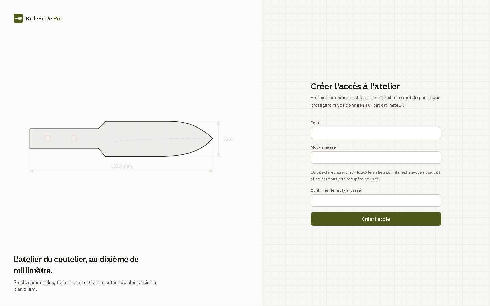

Puis un court assistant demande le nom de l'atelier, son logo, et s'il faut garder les données de
démonstration.

**Où sont mes données ?** Sur cet ordinateur seulement, jamais chez l'éditeur :
`%LOCALAPPDATA%\KnifeForge Pro` (Windows), `~/.local/share/knifeforge-pro` (Linux),
`~/Library/Application Support/KnifeForge Pro` (macOS). Le bouton *Dossier des données* de la
petite fenêtre l'ouvre.

> **Limite** : KnifeForge n'écoute que sur l'ordinateur où il est installé. Pour l'ouvrir depuis
> plusieurs postes ou un téléphone, installez plutôt la version serveur (Docker, voir le README).

### Votre métier

Au premier lancement, puis dans *Réglages › Métier et étapes d'atelier* : **Coutelier** ou
**Forgeron / ferronnier**. Le métier règle le vocabulaire (« modèle de couteau » ou « modèle
d'ouvrage »), les étapes proposées et les outils affichés (crantage et pliants pour le
coutelier). Rien n'est perdu en changeant.

Les **étapes d'atelier** se renomment, s'ajoutent (damas, étui en cuir, galvanisation…), se
retirent et se réordonnent ; la dernière est celle où la commande a quitté l'atelier.

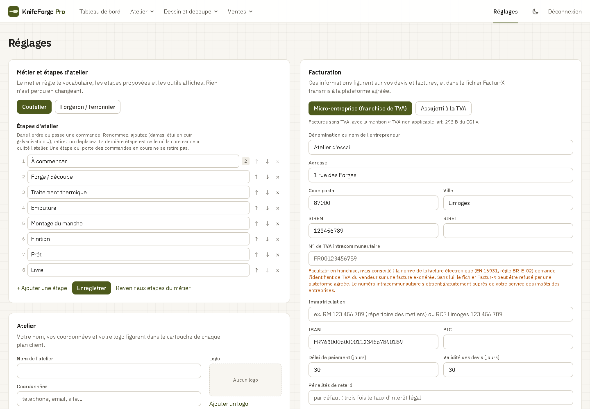

## 2. Le tableau de bord

C'est la page d'accueil : la date, les commandes en cours et celles à livrer cette semaine, la
marge potentielle, le facturé du mois et ce qui reste à encaisser, les commandes par état et par
étape d'atelier, les dates promises, le facturé sur six mois, les matières sous leur seuil
d'alerte, et combien de brouillons de commande le stock actuel permet de fabriquer.

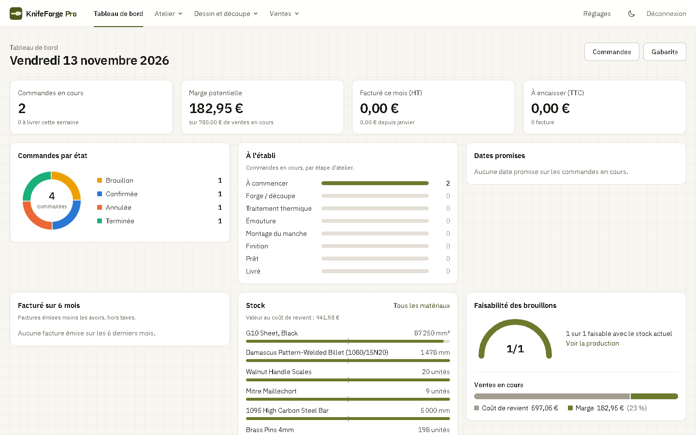

Chaque bloc mène à sa page (commandes, matières, production). Le menu regroupe le reste en trois
sections : **Atelier** (production, matières, recettes de traitement, modèles), **Dessin et
découpe** (gabarits, nesting, contrôle de découpe), **Ventes** (clients, commandes, devis et
factures).

> **Limite** : le tableau de bord se recalcule à chaque ouverture, pas en continu.

## 3. Dessiner une lame

*Dessin et découpe › Gabarits › Nouveau gabarit*. Choisissez un point de départ (page vierge, lame
drop-point, lame de pliant, plaquette, garde, planche de contrôle), un nom, et si vous voulez le
modèle de couteau et la matière auxquels le gabarit se rattache.

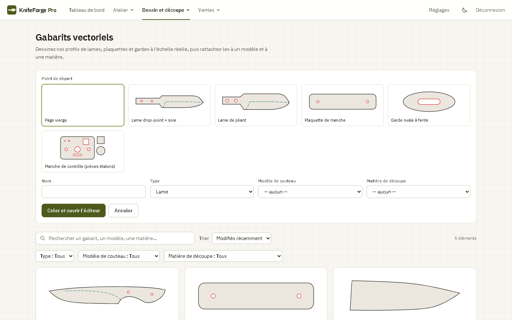

L'éditeur dessine en **millimètres réels**, sur une grille millimétrée.

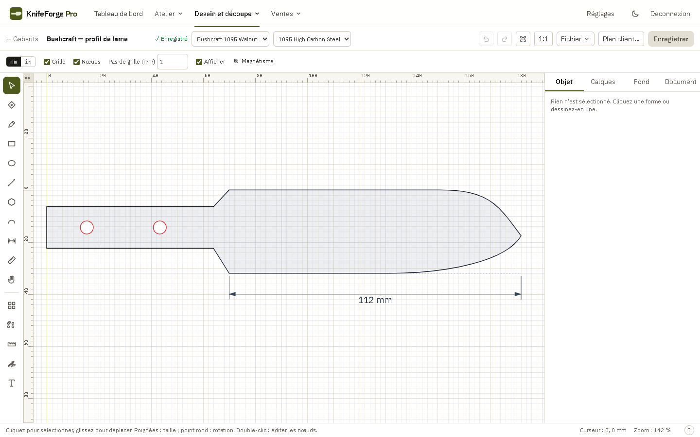

L'essentiel :
- **Calques** : *Découpe* (contours découpés), *Perçages* (retirés des pièces qu'ils
  recouvrent), *Gravure*, *Émouture* (tracée sur les plans, jamais découpée), *Construction*
  (aides, jamais exportées), *Cotes*.
- **Formes** (*Bibliothèque*) : 19 profils de lames paramétriques (drop-point, clip, lance, tanto,
  wharncliffe, pied de mouton, pointe relevée, skinner, bowie, office, gyuto, santoku, nakiri,
  kiritsuke, et cinq lames de pliant : drop-point, laguiole, feuille de sauge, London, Yssingeaux), plaquettes,
  gardes, rondelles, fentes de soie. Saisissez les dimensions : la forme est construite à la cote.
  Les lames fixes viennent avec leur soie pleine dessinée en manche (choil d'affûtage, garde,
  creux de l'index, renflement de paume) ou, pour les couteaux de cuisine, avec un talon droit ;
  les lames de pliant avec leur talon arrondi autour du pivot.
- **Courbes** : outil Plume pour les nœuds, outil Nœuds pour tirer un segment et le courber ;
  congés et chanfreins sur un angle ; arc par 3 points ; symétrie.
- **Saisie au clavier** : pendant un tracé, tapez une longueur et validez par Entrée.
- **Image de fond** : importez une photo ou un scan de votre croquis, calibrez-la sur une
  longueur connue (et redressez la perspective d'une photo prise de biais), puis décalquez.
- **Magnétisme** sur la grille, les nœuds, les milieux, les guides ; **mesure** entre deux
  points.

*Fichier › Enregistrer* (ou Ctrl+S) garde le gabarit ; l'historique (Ctrl+Z) annule pas à pas.

> **Limites** : pas de style par objet (couleur de remplissage, épaisseur de trait), pas de
> groupes ; la cotation ne pose que des cotes alignées (pas d'angles ni de rayons).

## 4. Les outils du coutelier

### Millimètres ou pouces

Le bouton **mm / in** de la barre d'état bascule l'affichage et la saisie : règles graduées en
1/16 ou 1/8 de pouce, cotes, mesures et champs en pouces. Le dessin, lui, reste en millimètres,
avec la conversion exacte (1 in = 25,4 mm) : rien ne s'arrondit en passant de l'un à l'autre.

> Les plans clients et les fichiers exportés restent en millimètres (le DXF le déclare, les
> machines le lisent sans ambiguïté).

### Crantage et dentelure

Sélectionnez la pièce, puis **Crantage et dentelure**. Indiquez le tronçon (point de début et de
fin, sur le bord ; deux nœuds choisis avec l'outil Nœuds le remplissent), la forme des entailles (V, arrondies, fond plat), le pas, la largeur et
la profondeur ; les préréglages *dos* (crantage pour le pouce) et *tranchant* (dentelure) donnent
des valeurs de départ. Les entailles sont découpées dans la pièce, côté matière.

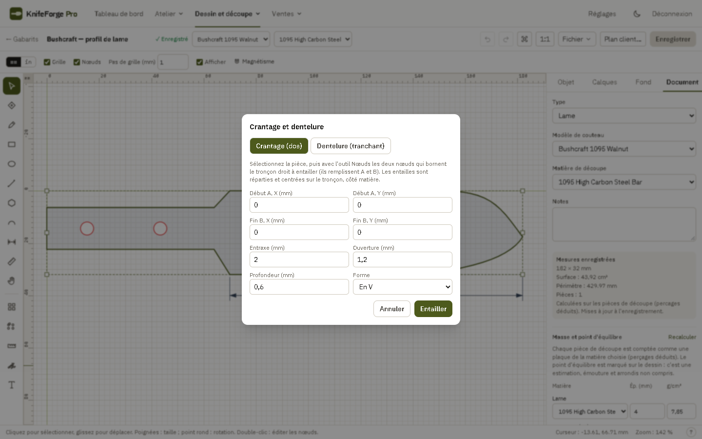

Cochez **Suivre le contour** pour un bord courbe (dos arrondi, ventre de la lame) : les entailles
suivent le bord de A à B, par le plus court, chacune perpendiculaire à la courbe.

> **Limite** : sur une courbe, la profondeur se mesure depuis la tangente au centre de l'entaille ;
> l'écart avec la courbe elle-même vaut largeur² / (8 × rayon), soit 0,02 mm pour une entaille de
> 1,2 mm sur un rayon de 10 mm.

### Pliants : la course de la lame

**Pliant : course de la lame** : désignez la lame, le point de pivot et les obstacles (manche,
butée, ressort). La lame tourne en silhouette fantôme autour du pivot ; *Vérifier la course*
la fait pivoter par pas de 0,5° et signale le premier contact (« contact à 37° avec la butée »)
ou le jeu minimal en fin de course.

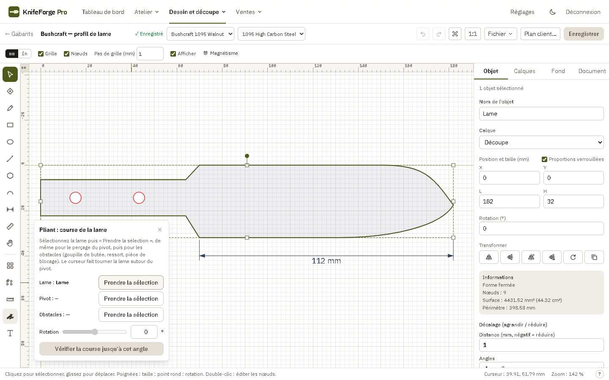

**Lame fermée** : désignez aussi le **manche** (le contour de la plaquette ou de la platine),
tournez la lame en position fermée, puis *Lame fermée : dans le manche ?* : KnifeForge donne la
marge minimale entre la lame et le bord du manche, ou de combien elle dépasse, avec la partie qui
dépasse en rouge sur le dessin.

> **Limite** : toute la lame est comparée au manche ; un dos de lame volontairement à fleur ou
> apparent ressort comme un dépassement de 0 mm ou plus, à juger sur le dessin.

### Masse et point d'équilibre

Onglet *Document* › **Masse et point d'équilibre** : chaque pièce de découpe prend une matière du stock
(la densité est devinée d'après le nom — acier, titane, G10, micarta, bois… — et reste
modifiable). *Calculer* donne la masse de chaque pièce, la masse totale et marque le point
d'équilibre sur le dessin.

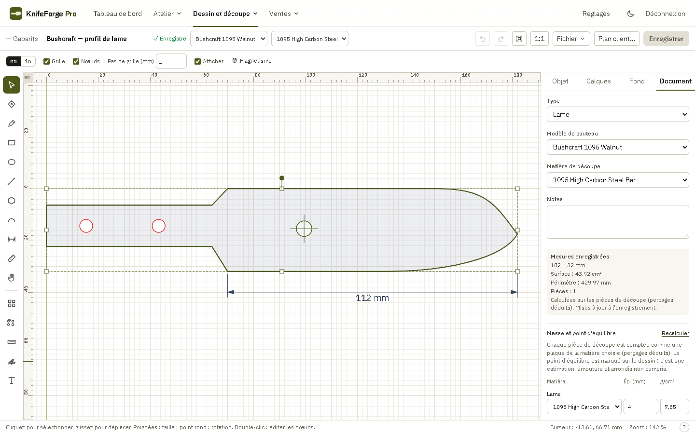

> **Limite** : chaque pièce est une plaque d'épaisseur constante ; l'émouture, les biseaux et les
> plaquettes galbées ne sont pas pris en compte. C'est une estimation pour comparer deux
> dessins, pas une pesée.

### Longueur développée et débit de forge

Sélectionnez un tracé, puis l'outil **Longueur développée et débit** (barre d'outils) :

- **Cintrer, enrouler** : pour une volute, un crochet, un anneau, une feuille cintrée, la longueur
  de barre à couper, mesurée sur la **fibre neutre**. Indiquez la barre (rond, carré ou plat, et
  si le plat est cintré sur chant), ce que représente votre tracé (l'axe de la barre, son bord
  intérieur ou son bord extérieur) et le coefficient de fibre neutre (0,5 à chaud ; jusqu'à 0,33
  pour un pli serré à froid). Ajoutez la surlongueur (prise en pince, mise à longueur) et la perte
  au feu : KnifeForge donne la longueur à débiter et le poids de barre.
- **Forger une pièce** : pour une pièce fermée (une lame à forger, par exemple), la longueur de
  barre d'une section donnée qui contient son volume (surface × épaisseur finie), pertes au feu
  comprises.

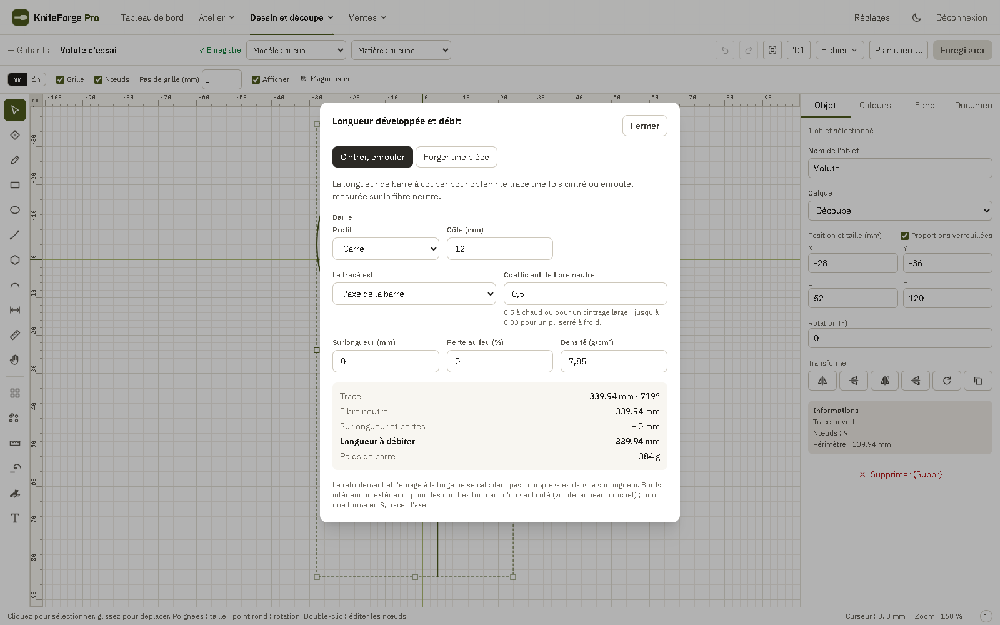

Le calcul est exact pour toute forme qui tourne d'un seul côté : la longueur d'une courbe décalée
vaut sa longueur plus le décalage multiplié par l'angle total dont elle tourne (vérifié contre une
spirale d'Archimède à moins de 0,01 mm).

> **Limites** : le refoulement et l'étirage à la forge ne se calculent pas (comptez-les dans la
> surlongueur) ; pour une forme en S, tracez l'axe de la barre ; le débit de forge suppose une
> épaisseur constante.

## 5. Exporter pour la machine, imprimer pour l'établi

Le menu **Fichier** de l'éditeur :

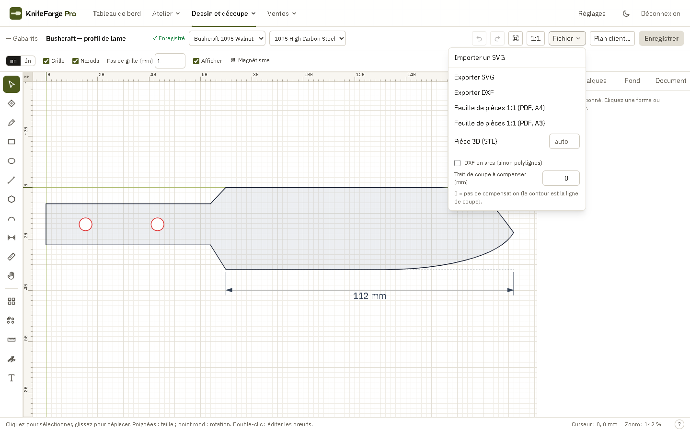

- **DXF** et **SVG** pour la découpe laser, jet d'eau, plasma ou CNC. Les courbes sont
  approchées à 0,01 mm au plus. Option *DXF en arcs* (sinon polylignes).
  **Trait de coupe à compenser** : indiquez la largeur du trait de votre machine ; les contours
  sont décalés de la moitié vers l'extérieur (et les perçages vers l'intérieur), la pièce sort
  à la cote. La valeur juste se mesure : voir [Contrôler sa découpe](#6-contrôler-sa-découpe).
- **Feuille de pièces PDF** (A4 ou A3) : les pièces à l'échelle 1:1, à coller sur l'acier, le
  bois ou le G10 pour travailler à la main. Une croix de pointage marque le centre de chaque
  perçage. Une pièce plus grande que la feuille est répartie sur plusieurs pages qui se
  recouvrent, avec des repères d'assemblage. **Imprimez à 100 %** (jamais « ajuster à la
  page ») et vérifiez la barre de 100 mm en bas de page.
- **Plan client** : un plan coté, en A4 ou A3, avec cartouche et barre de contrôle, à envoyer au client.
- **Pièce 3D (STL)** : les pièces extrudées à l'épaisseur indiquée, pour imprimer en 3D un
  gabarit de traçage ou de perçage, ou une maquette.

### Maquette 3D du couteau monté

*Fichier › Maquette 3D (impression, CNC)…* : pour juger la prise, l'encombrement et l'allure
avant de toucher à l'acier, ou pour montrer le projet à un client.

1. Donnez à chaque pièce son **rôle** et son **épaisseur** (devinés d'après leur nom :
   « Lame », « Plaquette », « Garde »…). Lame, garde, mitre et entretoise sont centrées ;
   platines puis plaquettes s'ajoutent de chaque côté. Un seul contour réglé sur
   « Plaquettes (paire) » donne la plaquette gauche et la droite.
2. Les **goupilles** sont créées d'elles-mêmes dans chaque perçage qui traverse au moins deux
   pièces, sur toute l'épaisseur traversée. La garde, la mitre ou l'entretoise sont **fendues**
   à la forme de la lame, pour s'enfiler sur la soie.
3. La **vue 3D** se tourne à la souris ; *Vue éclatée* écarte les plaques.

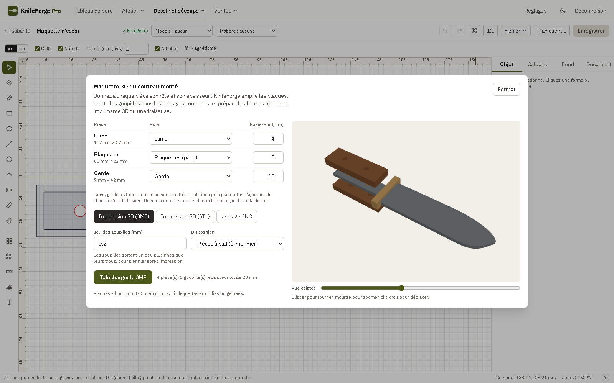

Puis selon votre machine :
- **Impression 3D** : un fichier **3MF** (une pièce par objet, en millimètres, couleurs par
  matière), pièces posées à plat ou couteau assemblé ; ou un **zip de STL**, un fichier par
  pièce. Le *jeu des goupilles* (0,2 mm par défaut) les rend un peu plus fines que leurs trous et
  élargit la fente de la garde d'autant.
- **Usinage CNC** (fraiseuse 3 axes : bois, résine, mousse, laiton) : un **DXF par plaque**, à la
  cote, l'épaisseur dans le nom du fichier, et un *LISEZMOI* avec les goupilles à couper. Saisissez
  le **diamètre de votre fraise** : KnifeForge signale les angles intérieurs trop serrés pour elle
  (et l'épaisseur de matière qu'elle y laissera) et les perçages plus étroits qu'elle (à percer).

> **Limites** : plaques à bords droits (ni émouture, ni plaquettes arrondies ou galbées) ; pas
> encore de fichier STEP pour la FAO (les DXF par plaque suffisent à un usinage 2,5D) ; les
> attaches qui tiennent les pièces pendant l'usinage se posent dans la FAO.

## 6. Contrôler sa découpe

*Dessin et découpe › Contrôle de découpe*. La preuve que la chaîne entière — dessin, export,
machine — tient le dixième, et la valeur de compensation propre à **votre** machine.

1. **Créer la planche de contrôle** : une plaque de 120 × 80 mm (coins R 10) percée de 3, 5,
   10 et 20 mm, avec une fenêtre carrée et une fente, plus un carré de 25 mm et un disque de
   30 mm. Exportez-la en DXF comme une vraie pièce, avec la compensation que vous utilisez
   d'habitude (ou 0), et découpez-la dans la matière à contrôler.
2. **Télécharger la fiche de relevé** : la planche à l'échelle 1:1 avec la lettre de chaque cote,
   et le tableau à remplir à l'établi.

   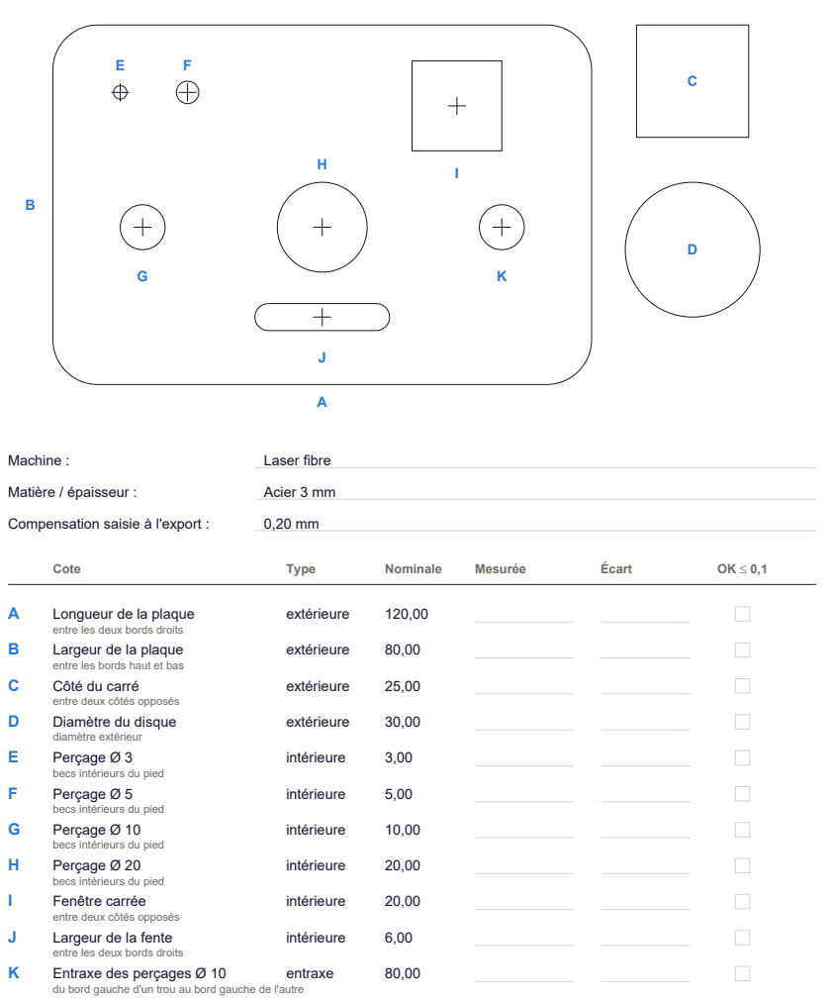

3. **Saisir les mesures** au pied à coulisse (la moyenne de deux mesures, pièce ébavurée),
   puis *Calculer*.

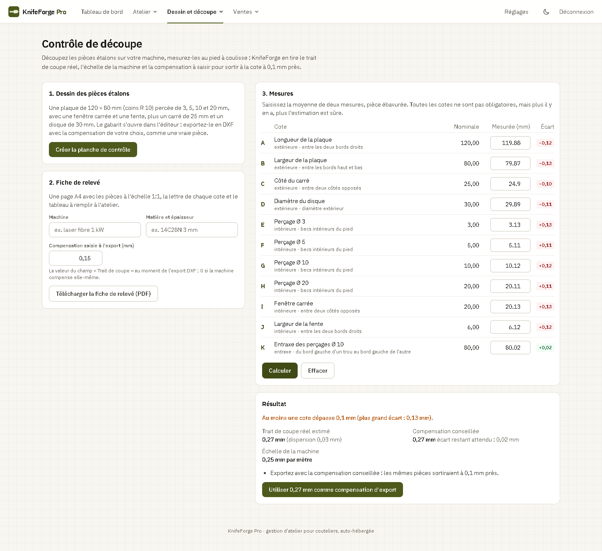

KnifeForge en tire :
- **le trait de coupe réel** : une cote extérieure trop petite ou un perçage trop grand veut dire
  que la machine enlève plus que la compensation saisie. Chaque cote en donne une estimation ;
  leur dispersion dit si la machine est régulière ;
- **la compensation conseillée** et l'écart qu'il resterait en l'utilisant ; le bouton *Utiliser…*
  la reporte dans le menu d'export de l'éditeur ;
- **l'échelle de la machine**, par l'entraxe des deux perçages de 10 mm, qui ne dépend pas du
  trait : un écart à cet endroit se règle sur la machine (pas par millimètre, jeu des axes), pas
  dans KnifeForge.

> Refaites le contrôle à chaque changement de matière, d'épaisseur, de buse ou de réglage de
> puissance : le trait en dépend.

## 7. Placer les pièces sur la matière

*Dessin et découpe › Nesting*. Choisissez une matière en barre ou en plaque : KnifeForge reprend
les gabarits des commandes en cours qui l'utilisent, place leurs vraies formes (perçages compris,
rotations autorisées) et compte les barres ou plaques nécessaires. L'**espacement** saisi entre
les pièces est un minimum garanti, jamais un « à peu près ».

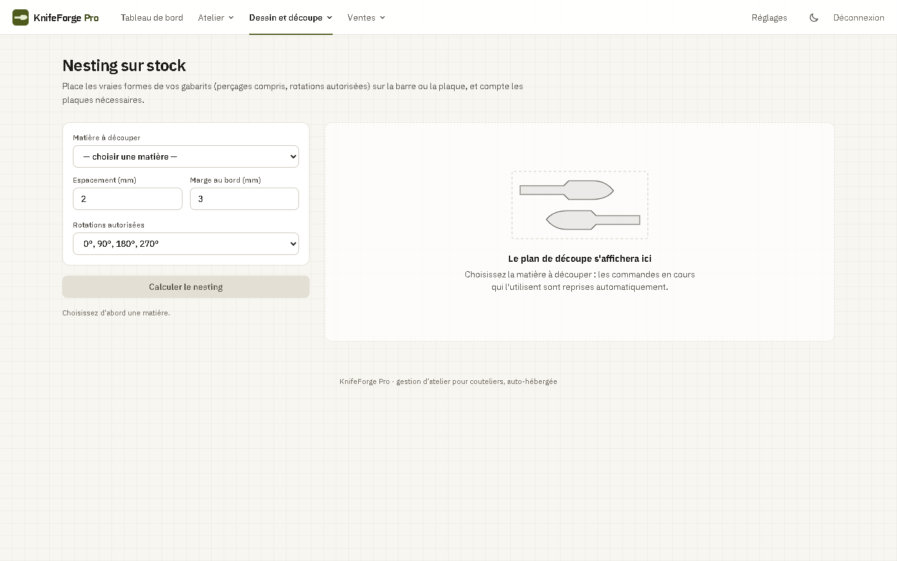

Le plan s'exporte en DXF / SVG pour la machine.

> **Limites** : le nesting est un plan de découpe, il ne retire rien du stock (c'est la
> confirmation de la commande qui le fait). Il ne réutilise pas encore les chutes, et les
> matières comptées à l'unité ne se nestent pas. C'est une méthode rapide et déterministe, pas
> une recherche de l'optimum absolu.

## 8. Prendre une commande et la suivre

*Ventes › Clients* d'abord (particulier ou professionnel ; un professionnel a son SIREN), puis
*Ventes › Commandes › Nouvelle commande* : le client, les modèles et quantités, la date promise.

- **Brouillon** : rien n'est réservé ; le tableau de bord dit si le stock suffit.
- **Confirmer** décompte le stock, **tout ou rien** : si une matière manque, rien n'est retiré
  et KnifeForge dit laquelle.
- **Étape d'atelier** : à commencer, forge / découpe, traitement thermique, émouture, montage du
  manche, finition, prêt, livré. Le tableau de bord compte les commandes à chaque étape.
- **Annuler** une commande confirmée remet la matière en stock.

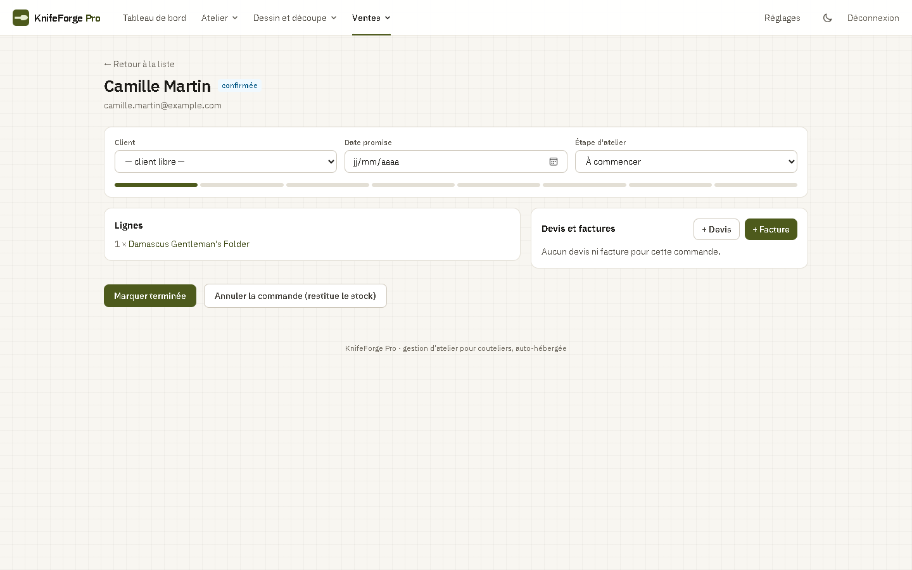

**Temps passé** : sur la commande, notez le temps de chaque séance (date, durée, étape, note).
KnifeForge le compare au temps prévu par les modèles de la commande et le chiffre au taux horaire
de l'atelier : de quoi savoir si le prix était juste.

Chaque mouvement de stock est écrit dans le journal de la matière (*Atelier › Matériaux*) : qui,
quand, pourquoi.

## 9. Devis, factures et avoirs

*Ventes › Devis et factures*, ou depuis une commande (*Devis* / *Facture* repris de ses lignes).

Avant d'émettre, renseignez une fois *Réglages › Facturation* : dénomination, adresse, SIREN,
régime de TVA (micro-entreprise en franchise, ou assujetti), IBAN, délais. Tant qu'il manque une
mention obligatoire, la facture le dit et ne s'émet pas.

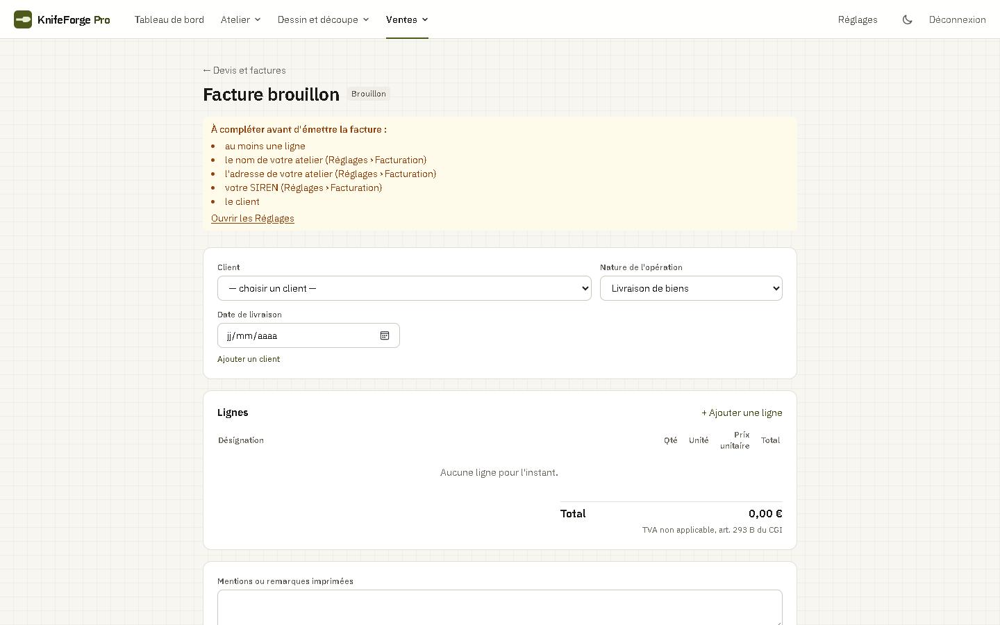

- **Émettre** numérote le document (numérotation continue, sans trou) et le **fige** : un
  document émis ne se modifie plus. Une erreur se corrige par un **avoir**, qui reprend la
  facture et la référence.
- Chaque facture émise est un **Factur-X** : un PDF lisible avec, à l'intérieur, les données
  structurées EN 16931 que lisent les logiciels du client et les plateformes agréées. À chaque
  version, des factures types sont vérifiées par un validateur indépendant (Mustang).
- Un devis accepté se transforme en facture.

### Acomptes

Depuis une commande, *+ Facture d'acompte* : indiquez le pourcentage (30 % par exemple), une
facture d'acompte est préparée sur cette part du prix. Elle se numérote comme les autres
factures et part en Factur-X avec le code des factures d'acompte. La **facture de solde** de la
commande déduit d'elle-même les acomptes déjà facturés (« Acompte facturé F-… », puis « Reste à
payer »), et jamais deux fois.

### Encaissements

Sur une facture émise, *Encaisser* : date, montant, moyen (virement, carte, chèque, espèces),
référence. Plusieurs encaissements se cumulent ; la facture passe d'elle-même à **payée** quand
il ne reste rien à payer, avoirs et acomptes compris. Un encaissement saisi par erreur se
supprime : la facture redevient à payer.

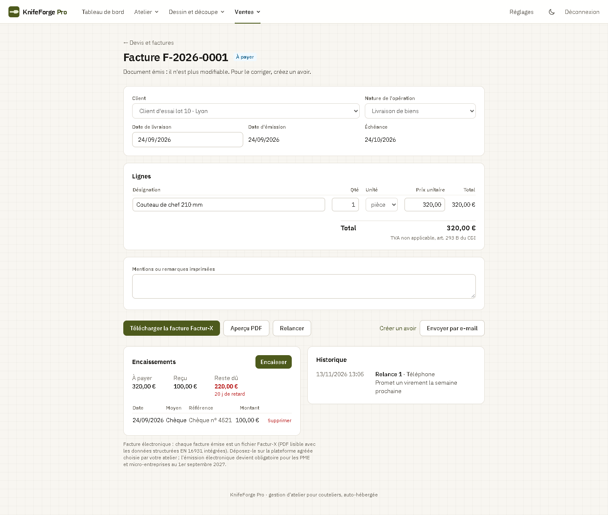

### Envoyer par e-mail

Réglez une fois *Réglages › E-mail* (le compte de messagerie de l'atelier ; la plupart des
fournisseurs demandent un « mot de passe d'application ») et envoyez-vous un essai. Ensuite,
*Envoyer par e-mail* sur un document émis prépare le message, avec le PDF (Factur-X pour une
facture) en pièce jointe ; tout se relit et se modifie avant l'envoi. L'envoi est noté dans
l'historique du document.

### Relances

*Ventes › Devis et factures* liste en tête les **factures en retard** : jours de retard, reste
dû, dernière relance. *Relancer* propose le niveau suivant :
1. un rappel courtois ;
2. un deuxième rappel, qui mentionne les pénalités ;
3. une **mise en demeure** (à envoyer de préférence en recommandé avec accusé de réception :
   copiez le texte, imprimez-le).

Une relance part par e-mail, ou se note quand elle est faite par courrier ou par téléphone (avec
une note : « promet un virement vendredi »). Les textes sont les vôtres si vous le souhaitez :
*Réglages › Comptabilité et messages*.

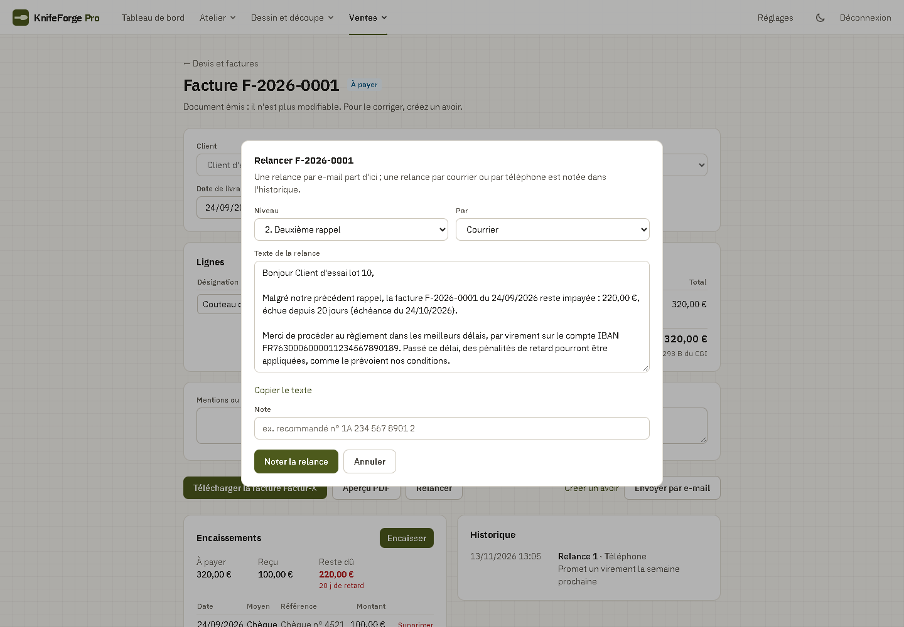

### Comptabilité

*Ventes › Comptabilité*, pour une période (mois, trimestre, année, ou dates choisies) :
- **en micro-entreprise** : le chiffre d'affaires **encaissé**, ventes de biens et prestations
  séparées, c'est-à-dire ce que vous déclarez à l'URSSAF ;
- **assujetti à la TVA** : en plus, la **TVA due** par taux et par période, selon la règle de
  chaque opération (à la livraison pour les biens, à l'encaissement pour les prestations et pour
  tous les acomptes, à la facture si vous avez opté pour les débits) ;
- **Journal des ventes (FEC)** : les écritures des ventes et des encaissements au format des
  colonnes du fichier des écritures comptables, que votre comptable importe dans son logiciel ;
  les comptes se règlent dans *Réglages › Comptabilité et messages* ;
- **Liste des ventes (CSV)** : une ligne par facture ou avoir, pour un tableur.

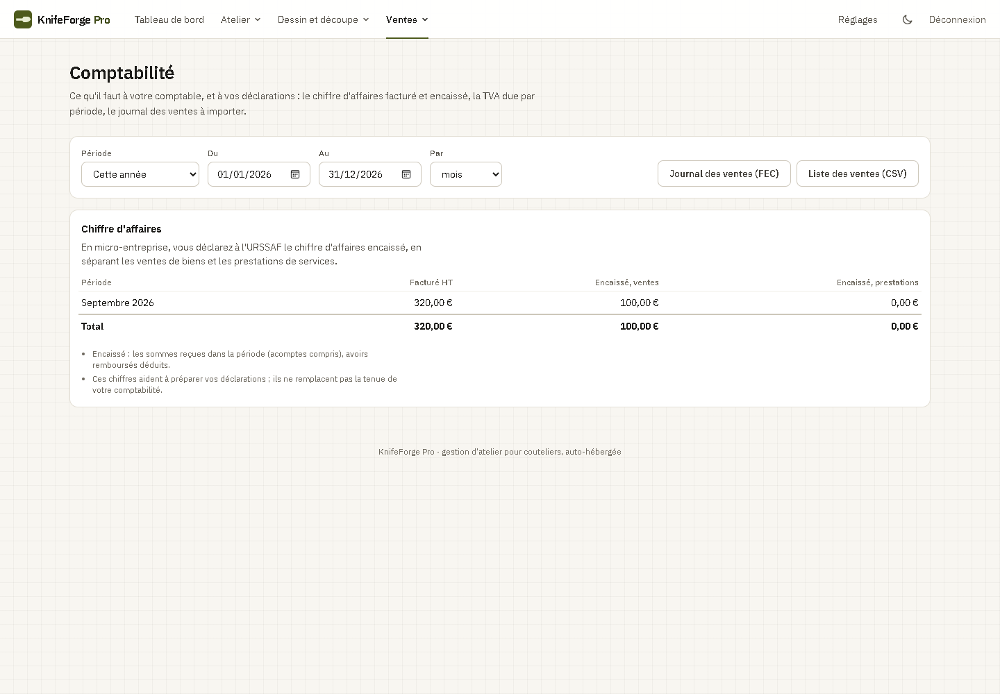

> **Limites** : KnifeForge ne transmet pas lui-même les factures à une plateforme agréée
> (obligatoire en émission au 1er septembre 2027 pour les TPE / PME) : déposez-y le PDF
> Factur-X. Le journal des ventes n'est pas un FEC complet (celui-ci vient du logiciel
> comptable, avec tous les journaux). Une facture mixte (biens et services) est comptée comme
> une vente de biens pour la TVA. Ces chiffres préparent vos déclarations ; ils ne remplacent
> pas votre comptabilité.

## 10. Sauvegarder, mettre à jour, déménager

*Réglages › Sauvegarde automatique* (version installée) : chaque jour, une sauvegarde complète
est écrite dans le dossier choisi. Choisissez **un autre support** que l'ordinateur : clé USB,
second disque, dossier synchronisé. *Sauvegarder maintenant* en fait une tout de suite.

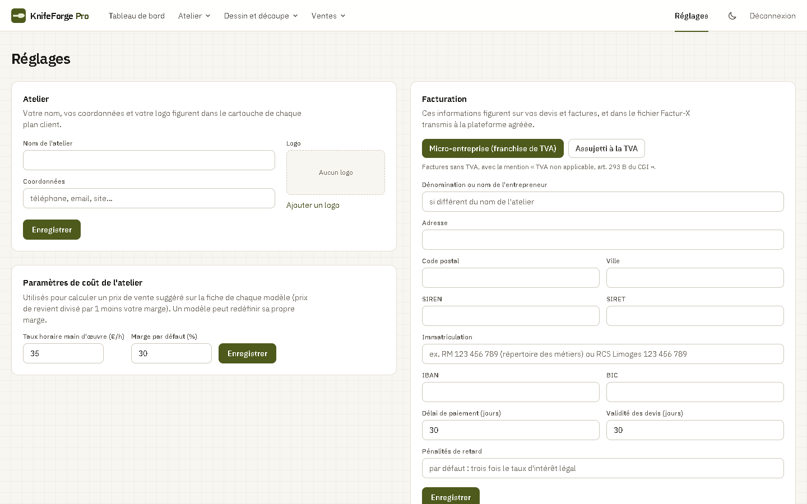

- **Sauvegarder à la main** : *Réglages › Sauvegarde des données › Télécharger une sauvegarde
  complète* (un fichier `.json` daté). Sans sauvegarde depuis 7 jours, le tableau de bord le
  rappelle (version installée).
- **Restaurer** : *Réglages › Sauvegarde des données › Restaurer une sauvegarde…*. KnifeForge
  montre d'abord ce que contient le fichier (date, atelier, nombre de clients, commandes,
  factures…), puis remplace tout, en une fois. Une sauvegarde faite avec une **version
  précédente** est mise à niveau comme lors d'une mise à jour, puis restaurée ; une sauvegarde
  faite avec une version plus récente est refusée (mettez d'abord ce KnifeForge à jour).
- **Mettre à jour** : lancez l'installeur de la nouvelle version, par-dessus. Au démarrage, la
  base est copiée dans *Sauvegardes avant mise à jour*, puis mise à niveau. Pour revenir en
  arrière : réinstaller l'ancienne version et remettre cette copie à la place de
  `knifeforge.db`.
- **Changer d'ordinateur** : installez KnifeForge sur le nouveau, créez votre accès, puis, dans
  l'assistant de bienvenue, *Reprendre ma sauvegarde…* : tout revient. De même pour passer d'un
  serveur Docker à l'installeur, ou l'inverse.
- **Désinstaller** ne supprime jamais vos données.

## 11. Questions fréquentes

**Changer mon mot de passe.** *Réglages › Accès* (version installée) : le mot de passe actuel, puis
le nouveau ; l'adresse e-mail peut changer en même temps.

**J'ai oublié mon mot de passe.** KnifeForge fermé, ouvrez `config.json` dans le dossier des
données, supprimez les lignes `admin_email` et `admin_password_hash`, relancez : l'écran de
création de l'accès revient, vos données sont intactes.

**L'écran n'affiche pas les pièces à leur vraie taille au zoom 1:1.** Calibrez l'écran une fois :
*Réglages › Affichage à taille réelle*, avec une carte bancaire posée contre l'écran.

**La feuille imprimée n'est pas à la bonne taille.** L'imprimante a mis la page à l'échelle :
choisissez « taille réelle » ou « 100 % » dans la boîte d'impression, et vérifiez la barre de
100 mm.

**KnifeForge démarre lentement la toute première fois.** C'est l'antivirus qui analyse les
fichiers du programme ; les démarrages suivants sont rapides. Si le démarrage reste bloqué, le
dossier *Journaux* contient `knifeforge.log` (et `demarrage-lent.txt` au bout de 90 secondes) :
joignez-les à votre demande d'aide.

**Mes données partent-elles quelque part ?** Non. KnifeForge n'envoie rien à l'éditeur ni à
personne : pas de compte en ligne, pas de télémétrie. Vous restez seul responsable — et seul
détenteur — des données de vos clients.
